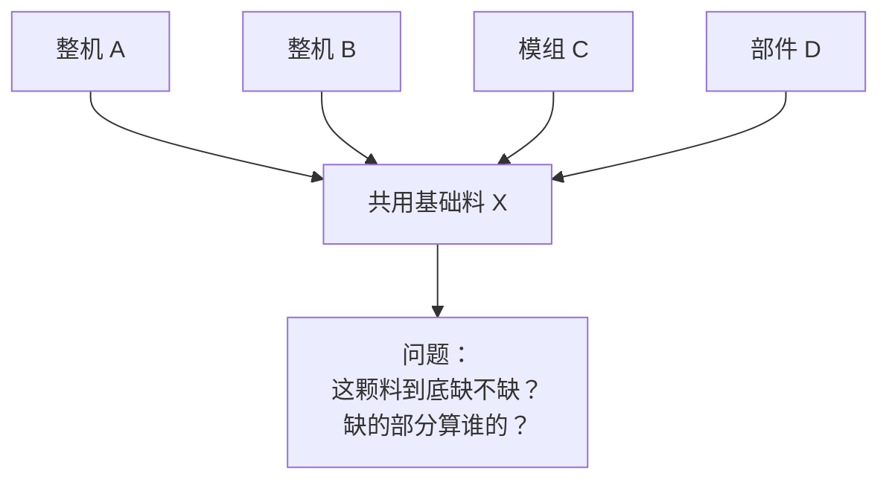
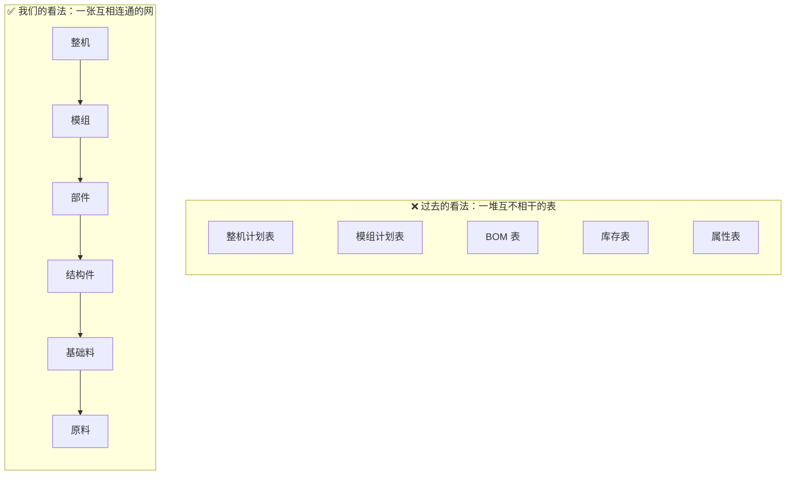
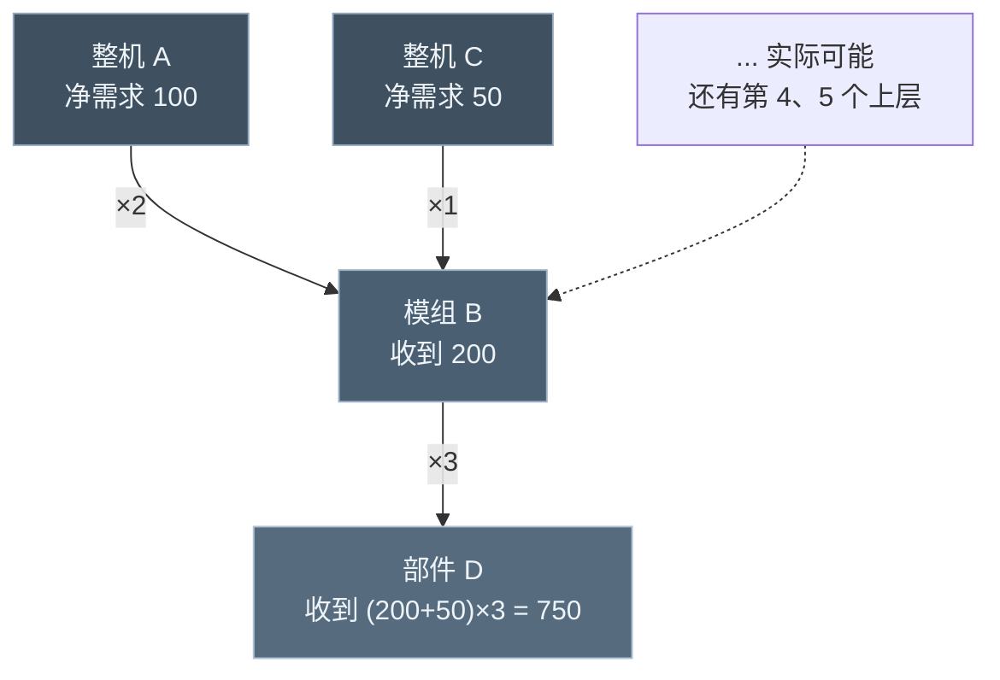
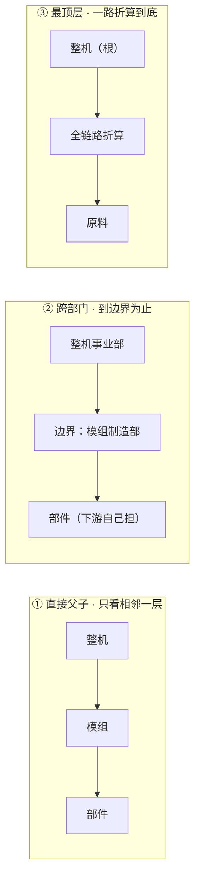
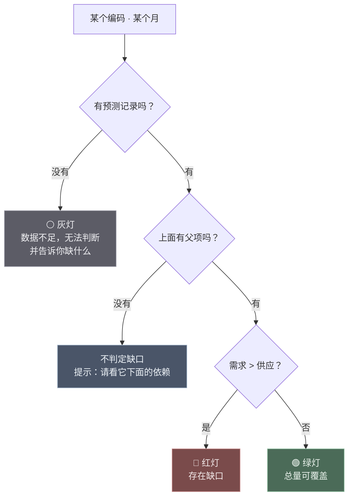
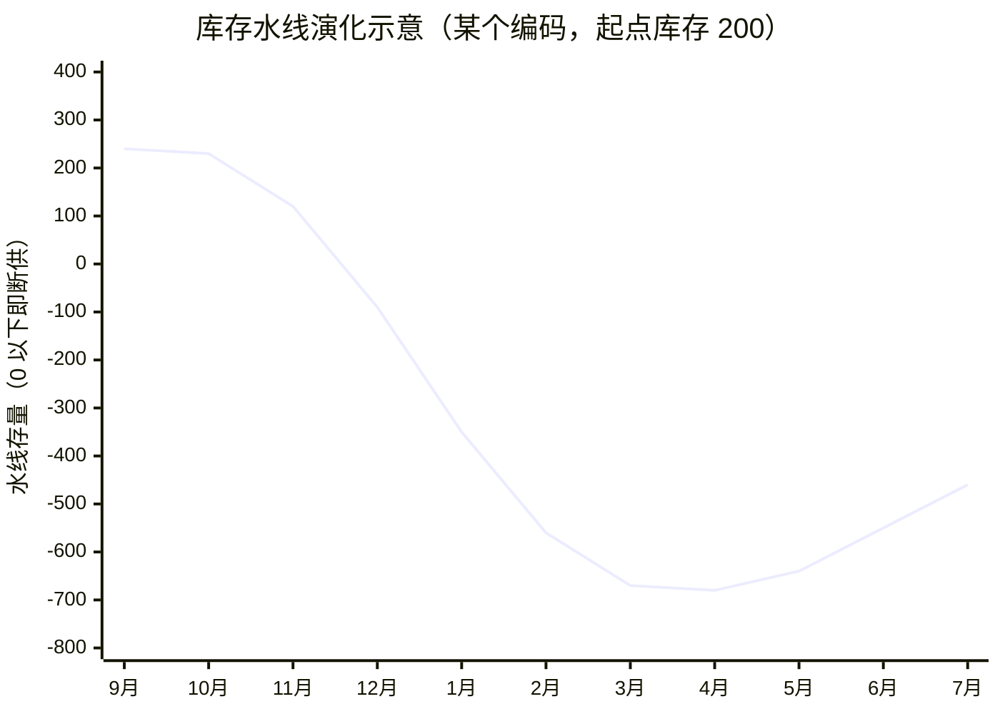
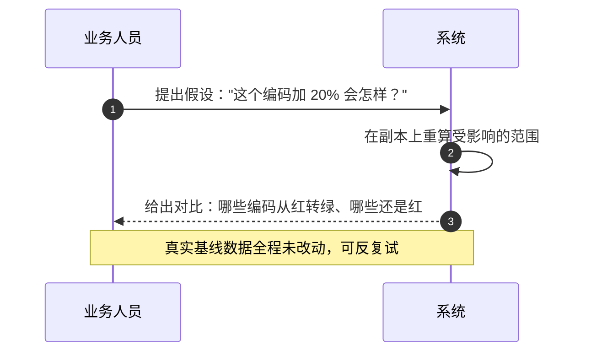
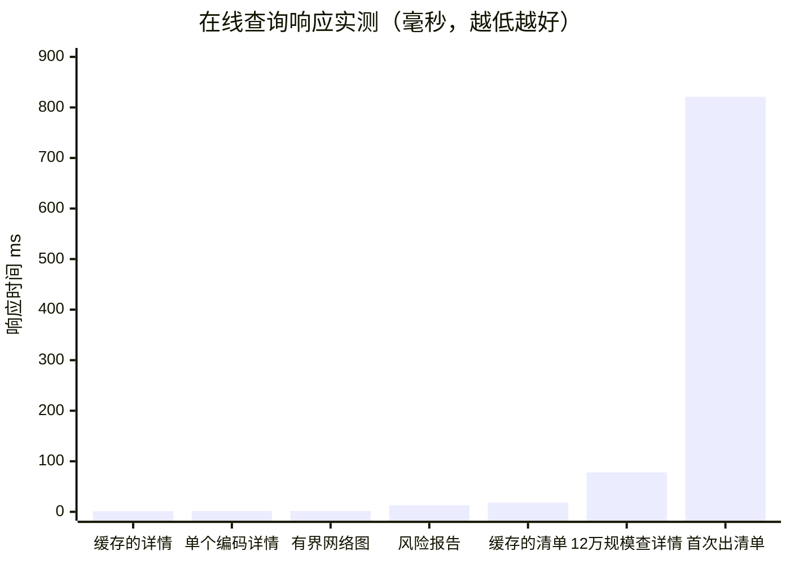

# 让供应链风险"看得见"

### 多层物料供需缺口预警能力 · 宣讲材料

> **一句话讲清楚**  
> 我们把上万颗物料、七层加工关系，变成**一句看得懂的结论**和**一份能落地的行动清单**。  
> 不需要业务同事学新系统，也不需要改变现有的数据填报方式。

| 适用场景                      | 汇报对象            | 阅读时长                |
| ------------------------- | --------------- | ------------------- |
| 能力汇报 / 立项说明 / 业务宣讲 / 项目验收 | 领导、业务专家、计划与采购骨干 | 讲 20～30 分钟，读完 10 分钟 |

---

## 目录

| 章节 | 内容               | 对应的问题     |
| -- | ---------------- | --------- |
| 一  | 从一个真实场景说起        | 为什么要做这件事  |
| 二  | 我们面对的五个真问题       | 难在哪       |
| 三  | 我们是怎么解决的         | 怎么做到的     |
| 四  | 做出来是什么样          | 交付物与效果    |
| 五  | 和过去比，强在哪         | 价值对比      |
| 六  | 我们守住的四条底线        | 为什么可信     |
| 七  | 三句话总结            | 请领导记住的三件事 |
| 附录 | 宣讲时最可能被问到的 8 个问题 | 现场应答      |

---

## 一、从一个真实场景说起

**先讲一个场景。**

某个机型临时追加排产，计划员把下个月的预测调高了三成。三天后，车间报缺料——缺的是一颗不起眼的紧固件。

事后复盘，每个人都觉得不是自己的问题：

- **计划员**说："我只管整机那层，谁知道下面那颗小料够不够？"
- **采购**说："这颗料又不是只供你一个机型，凭什么说是我欠你的？"
- **车间**说："料到了自然会生产，我哪知道它三天前就该到？"

**但真正的问题是——这个缺料，在改预测的那一天，其实是"算得出来"的。**

只是没人算得出来。因为要回答"这颗紧固件够不够"这一句话，背后得先回答五个连环问题：

| # | 这一句结论背后，实际要回答什么        | 靠人工             |
| - | ---------------------- | --------------- |
| 1 | 这颗料上面挂着哪几个机型、哪几个模组？    | 要翻 BOM，一层一层找    |
| 2 | 每个上层各自要多少？同一颗料被几条路径引用？ | 路径会重复，容易算重      |
| 3 | 那几个上层之间，需求要不要合并？       | 口径不统一，各说各话      |
| 4 | 跨部门的，算到哪一层为止？          | 没有统一规则，全靠约定     |
| 5 | 数据没维护全的那些，算不算"够"？      | 通常被当成"够"——这正是隐患 |

> **这道题的难点不在"算术"，而在于：这是一张网，不是一张表。**

我们做的，就是**把这张网完整地算一遍**，并且让结果能直接用来指导行动。

---

## 二、我们面对的五个真问题

下面这五个问题，是这套能力要正面解决的，也是业务上最疼的地方。

| # | 问题（业务语言）            | 现象                      | 后果                        |
| - | ------------------- | ----------------------- | ------------------------- |
| ① | **链太长，眼睛太短**        | 一个机型变动，影响会沿着 BOM 一层层放大  | 风险在最上游爆出来时，已经来不及          |
| ② | **共用料的账，谁都想按自己的算法** | 同一颗料被十几个上层引用，每个上层都说"我要" | 会上扯不清，缺口被重复认领             |
| ③ | **跨部门那一刀切在哪**       | 需求向下传到部门边界，算谁的？         | 部门之间互相推，或者重复计数            |
| ④ | **没数据 ≠ 没风险**       | 编码没维护计划，表格里显示为 0        | **最危险的情况：把"不知道"显示成"没问题"** |
| ⑤ | **一万个编码，人工算不动**     | 多层 × 多月份 × 多版本          | Excel 打开就卡，改一个数全表重算       |

### 问题① 链太长，眼睛太短

一个整机缺料，往往不是因为整机本身计划少，而是它下面第 5 层的一颗基础料掉了链子。

压力是怎么放大的？举个例子：整机要 100 台，装 1 台整机需要 2 个模组，1 个模组需要 3 个部件……

**图 1 · 需求沿 BOM 逐层放大（示意）**

**手工翻这几层，要一小时；翻完还要保证没算重、没算漏。**

### 问题② 共用料的账，谁都想按自己的算法

越往下的料，越"万人迷"。一颗基础料可能同时供十几个上层。

**图 2 · 共用料的"人人有份"困境**

**我们的答案很明确：这颗料的缺口是"总量缺口"，属于这条供应链整体，不分配给任何一个上层。** 谁都不认领，但所有相关方都能看到同一个数字——这才是能开会讨论的基础。

### 问题③ 跨部门那一刀切在哪

需求从整机往下传，传到部门边界时，是继续往下穿，还是就此打住、由下游部门自己对？

这个问题没有"对错"，只有"规则"。**关键是规则必须写清楚、能复现。** 我们把三种常见规则都做成了标准选项，见第三章 3.3。

### 问题④ 没数据 ≠ 没风险（我们最在意的一条）

这是整套能力里，**我们最想强调的一点**。

在表格里，下面两件事长得一模一样：

| 实际情况            | 表格里看到的       | 真实含义           |
| --------------- | ------------ | -------------- |
| 这个月计划产出 **0 件** | 0            | 明确知道：这个月没有产出   |
| 这个月**根本没填**计划   | 0（或者空白被当成 0） | **完全不知道会产出多少** |

如果两者都按 0 处理，系统就会把"没填数据"的编码判定&#x4E3A;**"供应充足、没有风险"**。

> **这是最危险的错误——不是报警报错，而是该报警的时候一声不响（漏报）。**

### 问题⑤ 一万个编码，人工算不动

| 规模项               |                          数量 |
| ----------------- | --------------------------: |
| 物料编码              | 1,004 条（当前业务快照）；已验证规模 12 万条 |
| 父子关系              |       1,902 条；已验证规模 59.4 万条 |
| BOM 层数            |              7 层；已验证规模 10 层 |
| 加工地               |                        58 个 |
| 月份                |                       11 个月 |
| 组合数（编码 × 月份 × 口径） |         3.3 万个单元格，**每个都要算** |

**这不是"多加几个人"能解决的问题，这是方法问题。**

---

## 三、我们是怎么解决的

### 核心思路一句话

> **把物料关系看成一张网，让需求像水一样沿着网往下流，在每一个节点上量一次水位。**

水往低处流，需求往底层走。我们要做的就是在每一个编码节点上回答两个问题：**上面流下来多少（需求）、我这里有多少（供应）。** 两者一减，就是缺口。

下面七步，就是这套能力的全部。

---

### 3.1 第一步：把"一堆表"变成"一张网"

过去看数据是"一张张表"，我们把它重新组织成"一张网"：**每个编码是网上的一个点，每条父子关系是网上的一根线，线上标着"用几个"。**

**图 3 · 从"一堆表"到"一张网"**

变成网之后，两个过去做不到的事就成立了：

| 能力       | 说明                       |
| -------- | ------------------------ |
| **能顺着走** | 从整机一路走到底层的原料，需求逐层折算，一条不落 |
| **能倒着追** | 从一颗缺口料倒推：它被哪些上层引用、各占多大权重 |

---

### 3.2 第二步：让需求顺着网往下流

这是整套能力的心脏。用一句话说：

> **每一个编码，把自己"要用的量"乘以用料的倍数，交给它的下一层；下一层把自己收到的所有上层给的需求加在一起。**

**图 4 · 需求沿网逐层折算**

**这里有个关键细节，也是我们技术上最下功夫的地方：**

同一个下层，如果被多个上层、多条路径引用，它的需求是**要合并的**——因为不管从哪里来，最后都要流到同一个池子里。

> **打个比方：**  
> 想知道某个路口有多少车，最笨的办法是**追踪每一辆车从哪条路来、走了哪条路线**——车多了根本数不过来。  
> 聪明的办法是**只统计"每个方向流进来多少辆"**，到路口一加就行。
>
> 我们用的就是后者。**不追踪路径，只累加流量。**

这一步带来的差别是决定性的：

| 做法      | 算一颗料的成本                          |
| ------- | -------------------------------- |
| 逐条路径列举  | 层数越多，路径数**成倍暴涨**，10 层就可能上百万条，算不动 |
| 我们：沿途累加 | **每个编码、每条关系各走一遍，一次算完**，与规模基本成正比  |

**这就是为什么我们能从"几千个编码就卡死"，做到"12 万个编码照样跑"。**

---

### 3.3 第三步：把"算谁的"讲清楚——三种标准口径

同一个问题"够不够"，在不同岗位问的其实是三件不同的事。我们把它做成三个标准选项，用哪个、结论就带哪个标识，**再也不会出现"你的数和我为什么不一样"**。

| 口径       | 一句话解释               | 谁最关心    | 需求到哪停    |
| -------- | ------------------- | ------- | -------- |
| **直接父子** | 只看紧挨着的上一层要多少        | 车间 / 工序 | 只看相邻一层   |
| **跨部门**  | 出了本部门的口子，下游由下游部门自己担 | 部门长     | 跨部门边界处止步 |
| **最顶层**  | 从整机订单一路倒推到底         | 公司层面    | 全链路折算到底  |

**图 5 · 三种口径，三种边界**

> **为什么这件事很重要？**  
> 过去开会吵的往往不是"风险存不存在"，而是"按谁的口径算"。现在口径变成了**选项**，讨论就从"争执"变成了"选择"。

---

### 3.4 第四步：不知道就说不知道——"灰灯"机制

**这是整套能力里我们最坚持的一条。**

一般报表只有两种灯：

| 传统报表  | 问题                     |
| ----- | ---------------------- |
| 🔴 红灯 | 数据缺失时也报红 → **误报**，狼来了  |
| 🟢 绿灯 | 数据缺失时当成 0 → **漏报**，最危险 |

我们加了第三种，而且把它当成"一等公民"：

**图 6 · 红/绿/灰三态判定**

**灰灯的价值在于：它把"数据治理问题"暴露出来，而不是掩盖起来。**

| 灰灯的表述                     | 业务含义        |
| ------------------------- | ----------- |
| "3 个下层数据不完整，不能认定下层已经全部满足" | 而不是说"下层没问题" |
| "缺少当日库存快照，库存能否覆盖缺口尚不确定"   | 而不是说"库存够"   |
| "链路中存在未维护的加工周期，无法确认完整时长"  | 而不是报一个虚的数字  |

---

### 3.5 第五步：不只看"缺不缺"，还要看"什么时候缺、缺到多惨"

一个月的缺口只是快照。业务真正要的是趋势：**从哪个月开始缺？会持续多久？最惨是哪个月？**

我们把库存想象成一个**水池**，每月供应是进水管、需求是出水管，水位变化就是"水线"。

**图 7 · 库存水线：什么时候见底、跌到多深**

从这条线，业务一眼能读出三件事：

| 读出来的信息      | 数值              | 业务动作           |
| ----------- | --------------- | -------------- |
| **从哪个月开始断** | 12 月            | 倒推最晚什么时候必须下单   |
| **最惨是哪个月**  | 次年 4 月（水位 -680） | 提前锁定这段的产能/库存   |
| **要扛几个月**   | 连续 8 个月         | 评估是临时波动还是结构性缺口 |

> **这就是"看得见"的意义：不是告诉你"现在缺了"，而是告诉你"再不动作，两个月后会缺"。**

---

### 3.6 第六步：先试后做——沙盘推演

业务最怕的是"改一个数，把原来的基线弄乱了，还回不去"。

我们的做法：**推演完全独立于真实数据。** 你可以随便试：

| 想试的场景            | 系统怎么处理     |
| ---------------- | ---------- |
| "如果这个加工地产量加 20%" | 在副本上算，基线不动 |
| "如果某个加工地停工了"     | 在副本上算，基线不动 |
| "如果这批料有质量损失"     | 在副本上算，基线不动 |
| "如果交期往后延半个月"     | 在副本上算，基线不动 |

**图 8 · 沙盘推演：先试，再决定做不做**

**价值：把"试错的成本"从"一次生产事故"降到"一次点击"。**

---

### 3.7 第七步：还有两个容易被忽略的风险维度

除了"够不够"，还有两件事会要命：

**① 这条链要跑多少天？（加工周期链路）**

从最上游的料，一层层加工到整机，按各段平均工时累加，**最长的那条链需要多少天**——这决定了"要提前多久动手"。

| 我们给出的            | 不给出的                  |
| ---------------- | --------------------- |
| 按平均工时累计的最长依赖路径天数 | 不换算成"延误概率"（没有依据，不编数字） |
| 链路上哪一段周期波动大      | 不把波动直接说成"会延期"         |

**② 加工地靠不靠得住？（供应集中度）**

| 风险类型      | 含义                  | 我们的表述              |
| --------- | ------------------- | ------------------ |
| **单一加工地** | 只有一条腿走路，一停就是 100% 停 | "当月产出集中在一个加工地"     |
| **高度集中**  | 有第二条腿，但只能撑不到两成      | "最大加工地承担了 85% 的产出" |

> **一句必须加的限定语**：这表示**计划上的集中**，**不代表没有替代产能**。  
> 计划数据和产能数据是两回事，我们不去替业务下这个结论。

---

## 四、做出来是什么样

### 4.1 输入：还是原来的六张表，不需要额外采集

| 表           | 内容            | 必要性    |
| ----------- | ------------- | ------ |
| 月度产出预测      | 按版本、编码、月份、加工地 | **必需** |
| BOM 基表      | 父子编码 + 单位用量   | **必需** |
| 制造属性        | 制造部门、加工周期、波动  | **必需** |
| 产业映射        | 是否本产业         | **必需** |
| 库存快照        | 按日刷新的可用量      | 增强项    |
| 供应添加 / 使用剔除 | 人工微调量         | 可选     |
| 生产指令        | 计划产出与完工日期     | 可选     |

**关键点：业务同事的填报工作没有任何增加。**

### 4.2 输出：四类直接可用的结果

| 输出       | 是什么               | 给谁用          |
| -------- | ----------------- | ------------ |
| **风险清单** | 按严重度排序的编码列表，带风险标签 | 计划员每天看的第一张表  |
| **编码洞察** | 一句话结论 + 完整证据      | 需要向领导解释某个编码时 |
| **风险路径** | 从根到缺口的完整链路，标出风险分支 | 定位"问题出在哪一段"  |
| **推演对比** | 假设方案前后的差异         | 决策前评估        |

### 4.3 结论长什么样

不是一堆表格数字，而是**能直接复述给别人的一句话 + 支撑证据**：

> **【结论】** 发现供需风险，建议核对计划
>
> **当月**：供应 4,800，上层折算需求 5,600，**总量缺口 800**。  
> **加上库存**：最新库存 300（快照 2026-09-22），月内仍缺 **500**。  
> **多期趋势**：首个缺口月份 **2026-12**，最大缺口 1,150（**2027-04**），最长连续 **8 个月**不足。  
> **链路**：最长依赖路径 **65 天**（未含运输、排队与生产日历）。  
> **来源可追溯**：数据修订号、预测版本、月份、口径、供应来源，随结论一并返回。

### 4.4 效果：把数据规模变成"看不见的东西"

| 指标         |    当前业务快照 |       已验证规模 | 说明                  |
| ---------- | --------: | ----------: | ------------------- |
| 物料编码       |     1,004 | **120,000** | 规模提升 119 倍          |
| 父子关系       |     1,902 | **594,000** |                     |
| 全量算一遍耗时    | **66 毫秒** |     31.22 秒 | 含解析、校验、建网、计算、落盘     |
| 查一个编码的多年明细 |       毫秒级 |   **78 毫秒** | 库大了 119 倍，查一条还是这个速度 |

**图 9 · 响应时间实测（从 12 万编码规模的压测中抽取）**

> **一句话向领导解释这个表：**  
> **"数据从 1 千条涨到 12 万条，查一个人的资料还是几十毫秒。"**  
> 因为重活（把整张网算一遍）在**数据导入的时候**就干完了，平时查询只是"取出来 + 展示"。

---

## 五、和过去比，强在哪

| 维度     | 过去（Excel 单层比对） | 过去（汇总报表） | **现在**                 |
| ------ | -------------- | -------- | ---------------------- |
| 跨层传导   | ❌ 只看相邻一层       | ⚠️ 只看总量  | ✅ **全层自动折算**           |
| 共用料    | ❌ 识别不出         | ❌ 识别不出   | ✅ **自动合并，不重不漏**        |
| 口径     | ❌ 公式藏在个人表里     | ⚠️ 口径说不清 | ✅ **标准选项，随结论返回**       |
| 数据缺失   | ❌ 当成 0（漏报）     | ❌ 当成 0   | ✅ **灰灯 + 缺什么告诉你**      |
| 趋势判断   | ❌ 手工横拉         | ⚠️ 单一汇总  | ✅ **首缺月 + 最惨月 + 连续月数** |
| 加工地集中度 | ❌ 没有           | ❌ 没有     | ✅ **份额 / 单一 / 集中**     |
| 链路时长   | ❌ 没有           | ❌ 没有     | ✅ **最长链 + 波动**         |
| 试算方案   | ❌ 改表就毁基线       | ❌ 没有     | ✅ **沙盘推演，基线不动**        |
| 能不能复现  | ❌ 因人而异         | ❌ 版本混乱   | ✅ **同一输入必得同一结果**       |
| 规模上限   | 千级             | 万级（人工瓶颈） | ✅ **已验证 12 万级**        |

---

## 六、我们守住的四条底线

### 底线一：可追溯——每个结论都能被追问"凭什么"

每条结论都自带"身份证"：**数据修订号、预测版本、月份、口径、供应来源**。同一句话，任何时候都能复现出同样的结果。

### 底线二：不确定就说不确定

数据不足时，输出"无法判断 + 缺什么"，而不是输出"没问题"。

> **报表追求好看，我们追求可信。** 这是两件事。

### 底线三：不越界——只说数据支持的结论

我们明确拒绝三类"看起来很专业、实际没依据"的说法：

| 不说什么              | 为什么               |
| ----------------- | ----------------- |
| 不把"数据缺失"解读成"数量为零" | 这是漏报的根源           |
| 不把下层总缺口分配给某一个上层   | 共享供应无法唯一分配，会被重复认领 |
| 不把周期波动换算成"延误概率"   | 没有校准依据，说出来就是编数字   |

### 底线四：结果确定——不依赖"模型猜测"

同一份输入，永远得到同一份输出。不引入不可解释的猜测环节，结论可以被审计、被复盘、被追责。

---

## 七、三句话总结

> **第一句：看得早。**  
> 不是等缺料了才发现，而是在改预测的那一天就知道——**风险提前两个月浮出水面**。

> **第二句：说得清。**  
> 缺口是多少、按哪个口径、从哪个月开始、最惨是哪个月、最长链路多少天——**一句话讲完，还带着证据**。

> **第三句：撑得住。**  
> 从 1 千个编码到 12 万个编码，**查询仍是毫秒级**；数据导入时自动算完，平时不占人。

### 下一步可以往哪走

| 方向    | 一句话                       |
| ----- | ------------------------- |
| 粒度更细  | 从"月度总量"走到"日级齐套"，直接推停线日期   |
| 分配可执行 | 从"总缺口"走到"该怎么分供"           |
| 概率化预警 | 基于历史履约，给出**经过校准**的延误概率    |
| 网络更全  | 从 BOM 单网扩展到"多点物流往返"复合网络   |
| 与优化联动 | 识别风险 → 自动生成方案 → 评估效果，形成闭环 |

---

## 附录：宣讲时最可能被问到的 8 个问题

**Q1：这个和我们 ERP 里自带的缺料分析有什么不一样？**

ERP 的缺料分析通常只看**相邻一层**（或单张工单），能回答"这一层的直接子件够不够"。我们的能力是**跨全层**：从整机一路算到原料，并且识别**共用料的多路径合并**。这是 ERP 标准功能基本不做的事。

---

**Q2：为什么不用大模型 / AI？**

因为这件事**不需要猜，需要算准**。缺料的判断是确定性的数学问题，用 AI 反而引入了不可解释、不可复现的风险。我们的选择是：**结论必须可追溯、可审计**——所以整条计算链是确定性的，不引入大模型推理。

（补充：我们提供标准接口，未来如果要接智能问答，是"用自然语言去问这套确定性结果"，而不是"让模型去猜结果"。）

---

**Q3：数据不准怎么办？**

这正是我们做"灰灯"的原因。**数据不全，我们不会假装它没问题**，而是明确告诉你"这里数据不足、缺的是哪一项"。数据治理问题会被**暴露出来**，而不是被掩盖。

---

**Q4：它能替代人工判断吗？**

不能，也不打算替代。它替代的是**重复的、机械的、会算错的**那部分工作（逐层折算、找共用料、算总量），**把人的时间留给判断**：这个预测合不合理、要不要增产、增产给谁。

---

**Q5：多久能出结果？要等多久？**

导入完成后，**查询是毫秒级**。当前规模下全量计算只要 **66 毫秒**；即便是 12 万编码的规模，全量算一遍也只要 **31 秒**，而且这 31 秒是在**数据导入阶段**完成的，不占用日常查询的时间。

---

**Q6：结论准不准？怎么验证的？**

两条验证：

1. **和独立的"笨办法"逐条比对**——我们用"逐条路径列举"这种理论上绝对正确、但跑不快的算法作为参照，验证快速算法的结果完全一致；
2. **30 项回归测试全部通过**，覆盖三种口径、共用料、库存覆盖、加工地、关键链路、推演、多版本隔离等场景。

---

**Q7：会不会把所有编码都报成风险，变成"狼来了"？**

不会。风险分成四档：**风险 / 未知 / 关注 / 正常**，并且**按严重度排序**。日常工作中计划员看的是最上面那一小段——真正需要今天处理的。同时我们提供**风险筛选**，可以只看红灯。

---

**Q8：要业务同事做什么额外工作吗？**

**填报方式完全不变**，还是原来那六张表。唯一的建议是：把制造属性和加工周期维护得更全一些——**维护得越全，灰灯越少，结论越准。**

---

*本材料基于供应预测控制塔 v2.0.0 的实际实现与实测数据编写。性能数据来自本机（Node v24、i7-12700H、约 16GB 内存）单次测量，不含浏览器绘制、网络传输与多人并发，不同机器与负载下会有波动。*
